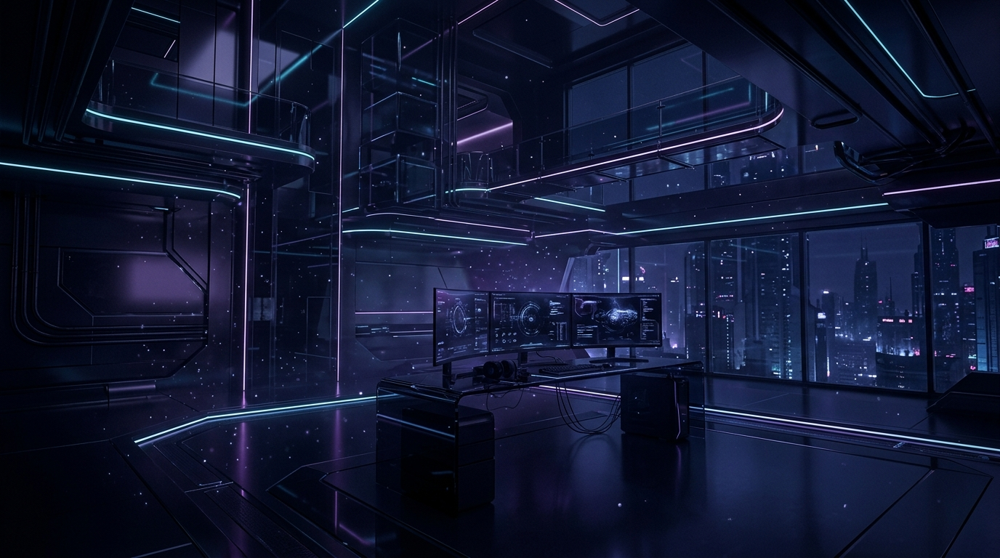

# ⚡ Tic Tac Toe Pro — Cyber Neon Edition

An enhanced, high-performance **Tic Tac Toe** web application built with modern vanilla HTML5, CSS3 Glassmorphism, and JavaScript. Features Smart Minimax AI, Web Audio API sound synthesis, Light/Dark themes, particle confetti celebrations, and local multiplayer.



---

## ✨ Features

- **🎮 Multiple Game Modes**:
  - `👥 2 Player (PvP)`: Local pass-and-play mode.
  - `🌱 AI Easy`: Casual game mode for beginners.
  - `⚔️ AI Medium`: Tactical bot that blocks wins and takes opportunities.
  - `🧠 AI God`: Unbeatable AI powered by the **Minimax Algorithm**.

- **🌓 Dark / Light Themes**:
  - Seamless toggle between **Cyberpunk Neon Dark Mode** and **Crisp Glass Light Mode**.
  - Persistent preference saved in `localStorage`.

- **🔊 Built-in Web Audio Synthesizer**:
  - Zero external audio files or network dependencies.
  - High-precision audio tones for moves, wins, ties, and tactile clicks.
  - One-click mute/unmute control.

- **🎉 Celebrations & Visual Effects**:
  - Dynamic **SVG Winning Strike Line** rendered across winning cells.
  - Fullscreen 60fps **Canvas Confetti Cannon** physics engine.
  - **Ghost Hover Preview** showing move indicator before clicking.

- **📊 Scoreboard & Match History**:
  - Real-time score tracker for Player X, Player O / AI, and Draws.
  - 🔥 **Win Streak Counter**.
  - Match history drawer logging past rounds with move counts.

- **⌨️ Keyboard Shortcuts**:
  - `1 - 9` : Place mark on board
  - `R` : Start New Round
  - `U` : Undo Last Move
  - `T` : Toggle Dark / Light Theme
  - `M` : Toggle Sound On / Off

---

## 🚀 How to Run Locally

### Option 1: Live Server / Python
```bash
# Clone the repository
git clone https://github.com/YOUR_USERNAME/tic-tac-toe.git

# Navigate into directory
cd tic-tac-toe

# Start local server (Python 3)
python -m http.server 8000
```
Open [http://localhost:8000](http://localhost:8000) in your browser.

### Option 2: Direct File Open
Simply double-click `index.html` to open directly in any modern browser!

---

## 🛠️ Built With

- **HTML5**: Semantic, accessible markup.
- **Vanilla CSS3**: Modern glassmorphism, responsive CSS grid, fluid typography.
- **Vanilla JavaScript (ES6+)**: Minimax algorithm, Web Audio API, Canvas particle engine.

---

## 📜 License

This project is open-source and available under the [MIT License](LICENSE).
